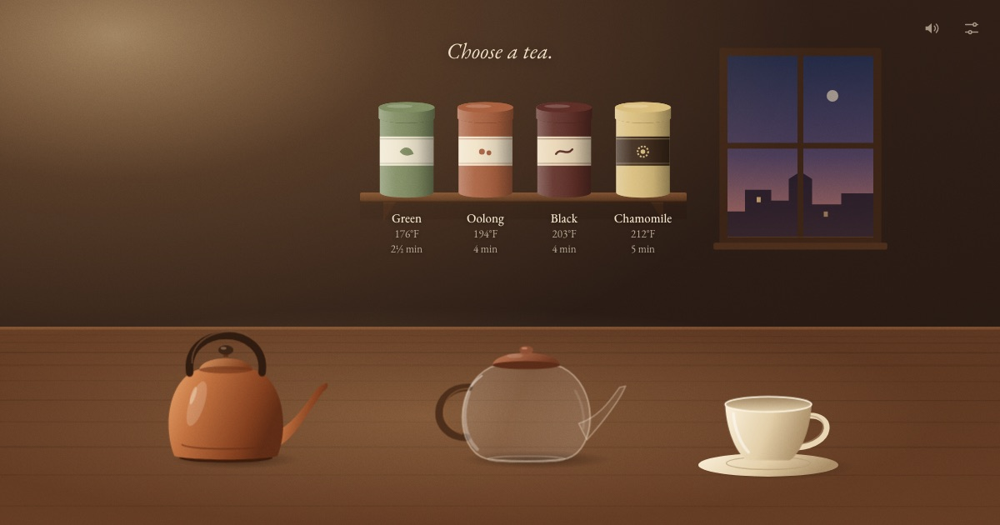

# Steep

**A single web page where you make one cup of tea, slowly, step by step, and end with a full, steaming cup and a quiet moment.**

Live at **https://steep-tea.vercel.app** (the deploy comes from pushes to `main`).



No account, no score, nothing to win. A visit takes three to six minutes. The steep times are real, so you can brew a real cup alongside.

## The ritual

1. **Arrive.** A dim room. "Let's make some tea." A tap anywhere (or Enter) turns the lamp up and starts the sound.
2. **Choose a tea.** Four tins on the shelf, each labelled with its water temperature and steep time. The chosen tin glides down to the table.
3. **Heat the water.** Press and hold the kettle. The rumble builds, bubbles start, steam rises from the spout, and a gauge fills toward a soft target mark. Let go near the mark. If you let go too early, hold again; nothing is lost. If it's too hot, it cools to the target by itself.
4. **Add the leaves.** The lids come off. Drag the scoop to the pot and it tips; the leaves (flowers, for chamomile) flutter down and settle.
5. **Pour the water.** Drag the kettle toward the pot. It lifts, tilts and pours for as long as you hold it there. The leaves swirl up. Let go any time and carry on later.
6. **Steep.** The lid goes on. The water darkens on a real-time clock: quickly at first, then slowly, as tea does. There are no numbers unless you turn them on. With the breathing cue on, a glow brightens for four seconds and fades for six.
7. **Pour the cup.** A soft two-note chime. Drag the pot over the cup; the liquid in the tilted pot stays level as the cup fills.
8. **Sit.** The cup steams, the room dims a little, the working sounds fade to room tone, and one closing line appears. "Make another" fades in after a few seconds; staying needs nothing.

There are no fail states. The scoop, kettle and pot each travel a fixed route, and your drag only decides how far along it they are, so nothing can be dropped or spilled.

## Decisions

The PRD left these open. Each was decided here, with the reason.

| Question | Answer shipped | Why |
| --- | --- | --- |
| Virtual ritual or real brewing companion? | **Both.** | Steep times are real and measured from the wall clock, so a backgrounded tab or a dimmed phone stays accurate. A timer fallback plays the chime even when the tab is hidden, and the screen is kept awake while it steeps (Wake Lock, where supported). With numbers on, the tab title counts down too. |
| 2D or 3D? | **2D**: hand-drawn SVG, with steam on a canvas. | The PRD lists 3D as a non-goal, and SVG fits the illustrated look. |
| Are four teas right, and what are their values? | **Green, oolong, black, chamomile**, with the values below. | They span the whole range of temperatures and times, which gives the heating step four different targets. |
| Sound on by default after the first tap? | **On.** | The first tap is the visitor choosing to begin, and half the calm is the sound. The mute button is always one tap away in the corner, and the choice is remembered. |
| Breathing cue on by default? | **Off**, as the PRD's feature table already says. | Turn it on in Settings. |
| What does the closing line say? Does it change? | **Six lines, one per visit, never the same twice in a row.** | For example: "Nothing else needs doing right now." and "Stay as long as the steam does." (all six are in `src/flow.ts`). One fixed line would wear thin by the third visit. |
| Where do the illustrations and sounds come from? | **Both are made in code.** | The art is SVG drawn in `src/scene/art.ts`. Every sound is synthesised live with the Web Audio API (`src/audio.ts`): filtered noise for room tone, rain, kettle rumble, pour and steam, plus short sine partials for bubbles, ceramic clinks, the tin and the chime. There are no files, so there is nothing to license. |
| What is the name? | **Steep.** | It's what the tea does, what the visitor does, and what the page asks of them. Short, and it's the one quiet verb in the ritual. |

Other choices:
- **Stack.** Vite and TypeScript with no framework, as the PRD suggested. A requestAnimationFrame loop writes SVG attributes directly. There is no GSAP: motion is exponential easing and slow ease-in-out curves.
- **Leaves are drawn in SVG, not on the canvas.** They have to sit inside the glass pot, behind its highlights and under the tea's colour; the canvas can only draw on top of everything.
- **Fahrenheit by default** for US-region browsers (`en-US` and the few others that use it), Celsius everywhere else. It's switchable in Settings.
- **Two calls against the PRD's "at most one line of text on screen at a time".**
  - **Tin labels.** The PRD also asks for "temperature and steep time in small type" on each tin. They show only while choosing.
  - **"Make another".** It's a quiet button at the bottom, not a second line of copy.

  Everything else keeps to one line, and during the steep the line fades out entirely.

### Tea values

These sit inside the PRD's ranges and agree with common brewing guidance, which is broadly consistent: green at 170–180 °F for 1–3 minutes, black near boiling for 3–5, oolong at 180–212 °F, herbal at a full boil for 5 or more. Sources: [Artful Tea temperature guide](https://artfultea.com/blogs/101/tea-brewing-temperature-guide), [1st-line brewing table](https://www.1st-line.com/customer-education/brewing-tea-basics/), [Consumer Reports](https://www.consumerreports.org/food/how-to-make-the-perfect-cup-of-tea-a3628637729), [Boulder Teahouse](https://www.boulderteahouse.com/whats-brewing-tea-blog/2021/8/10/how-to-brew-the-perfect-cup).

| Tea | Water | Steep |
| --- | --- | --- |
| Green | 80 °C / 176 °F | 2½ min |
| Oolong | 90 °C / 194 °F | 4 min |
| Black | 95 °C / 203 °F | 4 min |
| Chamomile | 100 °C / 212 °F | 5 min |

A tea specialist should still confirm these before launch, as the PRD asks (see the checklist). They live in `src/teas.ts`, and a test enforces the PRD's ranges.

## Accessibility

- **Keyboard.** Every step can be done from the keyboard.
  - Enter begins.
  - Tab and Enter pick a tin.
  - Holding Space or Enter on the kettle heats it.
  - On the scoop, kettle and pot, holding Space walks the same route a drag would.
  - Focus moves to each new step's control on its own.
- **Screen readers.** Each control is labelled ("Green tea. Water at 176 degrees Fahrenheit, steeps for 2 and a half minutes."). A polite live region gives each step's full description and the kettle's progress.
- **Reduced motion.** Automatic moves (the tin, the lids) crossfade instead of gliding. The leaves appear already settled. Steam rises half as fast and half as thick. The lamp doesn't flicker and the rain stops falling. Drags still move what you drag.
- **Mouse and touch** share one Pointer Events code path, with pointer capture, so a finger that slides off the kettle keeps pouring until it lifts.

## Analytics (off by default)

`src/analytics.ts` sends five events that map onto the PRD's success signals: `begin`, `tea`, `sit` (completion, with minutes since begin), `another`, and `linger` (seconds spent on the last step). Nothing is sent unless the build has `VITE_ANALYTICS=1`. It uses Vercel Web Analytics: no cookies, no personal data.

## Development

```bash
npm install
npm run dev              # http://localhost:5173
npm test                 # unit tests: kettle, steep clock, settings, flow, drag maths, tea values
npm run build            # typecheck + production build
```

`?pace=30` speeds the steep clock up 30× for development. The countdown still shows visitor time.

```
src/
  app.ts          the ritual: steps, input, per-frame update and render
  flow.ts         step order and closing lines
  kettle.ts       heating, cooling, and judging a release
  steep.ts        wall-clock steep timer and colour curve
  drag.ts         route-projected drags and easing
  teas.ts         the four teas and unit formatting
  settings.ts     settings in localStorage, defensively parsed
  audio.ts        synthesised sound
  ui.ts           mute, settings panel
  analytics.ts    opt-in events
  scene/
    art.ts        SVG illustrations and their geometry
    layout.ts     landscape and portrait arrangements
    steam.ts      canvas steam
```

The scene has two arrangements. The wide one serves desktops, tablets in landscape, and phones held sideways. The tall one serves phones in portrait, with the kettle, pot and cup on a diagonal so every pour moves up and to the right. Each is scaled to fit whole, and the wall and table extend past the edges so leftover space is still room.

## Deploying

Pushing to `main` deploys to Vercel. Never run `vercel deploy`: it uploads the working directory, not a commit.

## Launch checklist (owner)

- [ ] Have someone who knows tea confirm the four temperatures and steep times (the PRD asks for this).
- [ ] Optional: turn on Vercel Web Analytics for the `steep` project, set `VITE_ANALYTICS=1` as a production environment variable, and push. Custom events (completion, lingering) need a Vercel Pro plan; page views work on Hobby.
- [ ] Listen on real speakers and headphones. The levels were set by reasoning rather than by ear, because the headless test browser has no audio output.
